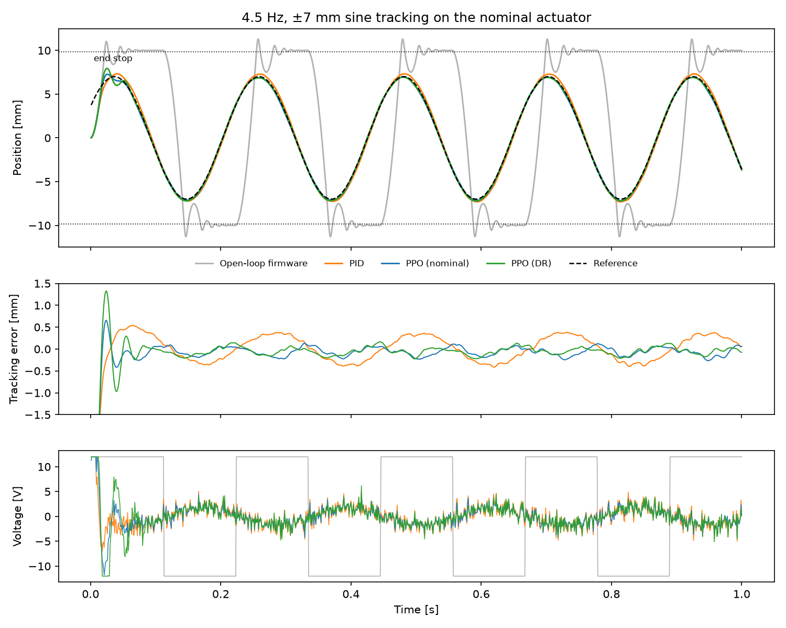
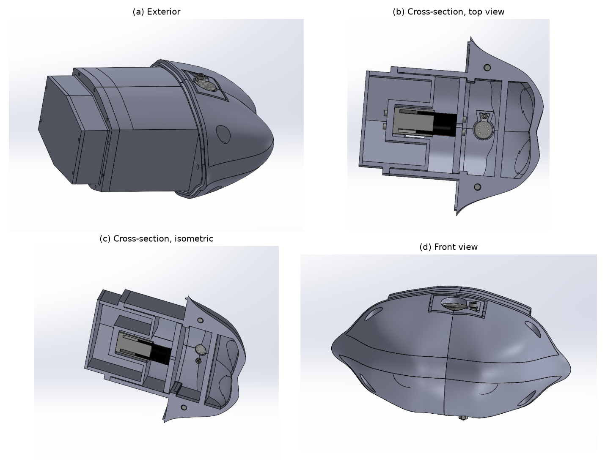
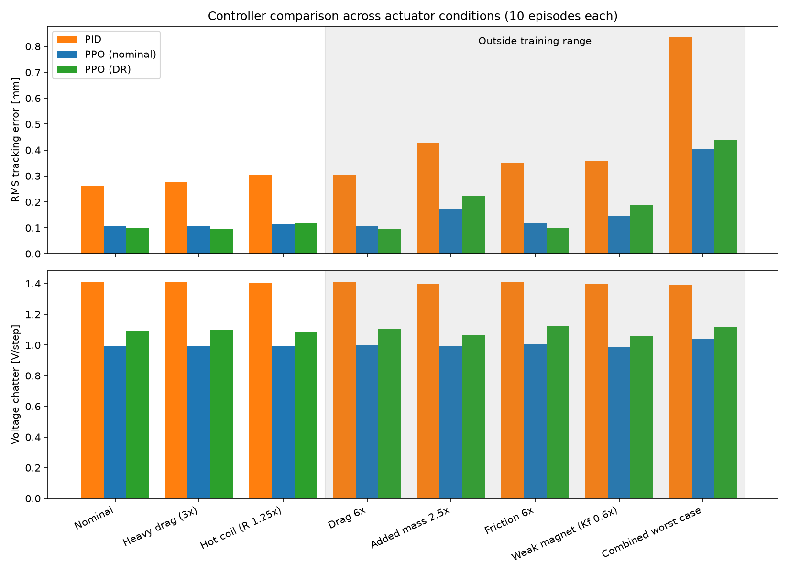

# Learning-Based Control of a Fluid-Loaded Voice Coil Actuator

**Simulation study comparing open-loop, PID, and reinforcement-learning (PPO) controllers for the underwater voice coil actuator of a cownose-ray-inspired suction device.**

> **TL;DR:** In a physics-based simulation of the actuator, a PPO policy tracks a 4.5 Hz, ±7 mm sine with **0.11 mm RMS error**. That is about **2.4× lower than a tuned PID** (0.26 mm), with less voltage chatter and **no end-stop impacts**. The existing open-loop firmware has ~9.7 mm error and spends **~54 % of the time on the end stops**. Across five out-of-distribution actuator conditions, PPO keeps a roughly 2–3× advantage over PID. Domain randomization did *not* clearly improve that robustness, and the [Discussion](#discussion) gives possible reasons.


*Nominal actuator, one episode ([plot_tracking.py](plot_tracking.py)). Top: position against the reference and the ±9.85 mm end stops. Middle: tracking error (start-up transient clipped). Bottom: commanded voltage. The summary numbers above come from [evaluate_all.py](evaluate_all.py) → [results.csv](results.csv).*

---

## Contents
- [Background](#background)
- [System and model](#system-and-model)
- [Control task](#control-task)
- [Controllers](#controllers)
- [Results](#results)
- [Discussion](#discussion)
- [Limitations and future work](#limitations-and-future-work)
- [Reproducing the results](#reproducing-the-results)
- [Repository layout](#repository-layout)

---

## Background

I'm a robotics design research assistant in **Zhong's Lab at Iowa State University** (since May 2026), where I work on a **cownose-ray-inspired suction device**. A voice coil actuator (VCA) moves a plate behind a membrane to generate suction underwater, and the motion has to be a smooth, repeatable oscillation at 4.5 Hz.

The device currently runs **open-loop firmware** on an ESP32 driving a DRV8871 H-bridge. The firmware applies a ±12 V square wave at 4.5 Hz with no position feedback. This has four problems:

1. **No feedback:** it can't correct its motion from position measurements.
2. **No adaptation:** it can't compensate when fluid or actuator properties change (drag, coil heating, load).
3. **Large voltage steps:** every half-cycle the full 24 V swing hits the coil.
4. **End-stop impacts:** the coil repeatedly slams into its mechanical stops, which could damage the robot.

This **independent project** (done in my own time, not an advised lab project) asks: *can a feedback controller, and in particular a learned one, produce the desired sinusoidal motion while avoiding these problems, and how robust is it when the actuator's physical parameters are uncertain?* I built a simulation of the actuator in water and compared four controllers in it.


*SolidWorks CAD of the cownose-ray-inspired suction device: (a) exterior, (b, c) cross-sections showing the voice coil actuator in the rear housing, (d) front view. Signal chain: ESP32 → DRV8871 H-bridge → VCA → plate/membrane → water. Individual renders are in [figures/cad/](figures/cad/).*

---

## System and model

The actuator is a moving coil with a rigidly attached plate, pushing water. The mechanical and electrical dynamics are

```math
(m + m_a)\,\ddot{x} = K_f\, i \;-\; b\,\dot{x} \;-\; c_d\,|\dot{x}|\,\dot{x} \;+\; F_{\text{stop}}(x,\dot{x}) \qquad \text{(Newton's second law)}
```

```math
L\,\frac{di}{dt} = V - R\,i - K_b\,\dot{x} \qquad \text{(Kirchhoff's voltage law)}
```

where $F_{\text{stop}}$ is a stiff spring–damper ($10^5$ N/m, 50 N·s/m) that engages only beyond the ±9.85 mm travel limit (19.7 mm total stroke). The silicone membrane is treated as compliant, with negligible stiffness ($k = 0$).

| Parameter | Value | Source |
|---|---|---|
| Moving mass $m$ | 0.1076 kg | SolidWorks mass properties (coil, 2 screws, plate) |
| Added mass $m_a$ | 0.186 kg | $\tfrac{8}{3}\rho r^3$ (disk), equivalent radius r = √(A/π) = 41.2 mm |
| Quadratic drag $c_d$ | 2.99 N·s²/m² | $\tfrac12\rho C_d A$, flat plate $C_d=1.12$, $A=0.005345$ m² |
| Force / back-EMF constant $K_f = K_b$ | 5.0 N/A | Estimate (typical 12 V VCA) |
| Coil resistance $R$ | 4.0 Ω | Estimate |
| Mechanical damping $b$ | 1.0 N·s/m | Estimate |
| Inductance $L$ | 1 mH | Estimate (neglected in the reduced model, see below) |
| Supply voltage | ±12 V | VCA datasheet / driver supply |

> Parameters marked *estimate* have not yet been measured on the hardware. This uncertainty motivated the robustness tests below.

### Model reduction: full model with LSODA → reduced model with RK4

The two models play different roles. The **full model** ([actuator_sim.py](actuator_sim.py)) is the reference. It keeps the inductance and is solved with SciPy's `solve_ivp` using LSODA, which adapts its step size and switches automatically between stiff and non-stiff methods (capped at 0.1 ms steps). That means I didn't have to hand-pick a step size for the stiff 3-state system. The **reduced model** ([actuator_model.py](actuator_model.py)) is what runs inside the controllers and the RL environment, millions of times. It makes two changes.

1. **Drop the inductance.** The electrical time constant $L/R = 0.25$ ms is shorter than the 1 ms control period. Within one control step the current settles almost fully to its quasi-static value $i = (V - K_b\dot{x})/R$, so the controller can't see the current dynamics or act on them. Removing them reduces the state from $(x, \dot{x}, i)$ to $(x, \dot{x})$.
2. **Replace LSODA with fixed-step RK4** (10 substeps of 0.1 ms per 1 ms control step):
   - **Zero-order hold:** the controller changes the voltage every 1 ms, which is a discontinuity in the input. An adaptive solver has to be restarted at every control step and loses most of its advantage. A fixed step aligns exactly with the control period.
   - **Stability is not a concern after reduction.** The fastest remaining dynamics is end-stop contact, with ω = √(k<sub>stop</sub> / (m + m<sub>a</sub>)) ≈ 584 rad/s. With h = 0.1 ms, ωh ≈ 0.06. That is far inside RK4's stability limit (|λh| ≲ 2.8), and the stiff solver features of LSODA aren't needed.
   - **Speed and determinism:** RK4 takes **48 µs per control step** vs. **146 µs** for the full model restarted with LSODA each step (3.0× faster). Every step also costs the same, which keeps training time predictable (3 M training steps, plus evaluation) and the results exactly reproducible for a given seed.
   - **Portability:** fixed-step RK4 is a few lines of arithmetic and could run on the ESP32, e.g. as the prediction model for a future model-based or MPC controller.

**Validation** ([validate_model.py](validate_model.py)): under the open-loop firmware drive, the reduced RK4 model differs from the full LSODA model by **0.15 mm RMS (0.69 mm max)**. The difference is concentrated at voltage reversals and end-stop impacts, which is small compared with the ±7 mm motion. The same script prints the per-step timing above.

---

## Control task

- **Goal:** command the coil voltage so that the plate tracks $x_{\text{ref}}(t) = 7 \text{mm}\cdot\sin(2\pi\cdot 4.5 t)$. This is the firmware's frequency, with an amplitude that stays inside the stroke.
- **Control loop:** 1 kHz.
- **Sensing:** position only, with Gaussian noise σ = 0.05 mm. Velocity is estimated by finite differences.
- **Actuation:** voltage saturated at ±12 V.

---

## Controllers

| Controller | Description |
|---|---|
| **Open-loop** | Replica of the current firmware: ±12 V square wave at 4.5 Hz, ignores the sensor. |
| **PID** | $K_p = 5000$ V/m, $K_i = 50{,}000$ V/(m·s), $K_d = 50$ V·s/m. First-order derivative filter (τ = 2 ms) plus integrator anti-windup. In an ablation, the filter cut voltage chatter from 5.4 to 1.45 V/step with no loss in tracking (0.27 → 0.26 mm RMS) ([pid_control.py](pid_control.py)). No feedforward. |
| **PPO (nominal)** | Stable-Baselines3 PPO, MLP policy, trained on nominal parameters for 1 M steps across 8 parallel environments. |
| **PPO (DR)** | Same algorithm and hyperparameters, trained for 2 M steps with **domain randomization**: each episode multiplies the parameters by a factor drawn uniformly from the ranges below. |

| DR parameter | Range (× nominal) |
|---|---|
| Added mass $m_a$ | 0.5 – 1.5 |
| Drag $c_d$ | 0.5 – 3.0 |
| Damping $b$ | 0.3 – 3.0 |
| $K_f$ (= $K_b$) | 0.8 – 1.2 |
| Resistance $R$ | 0.85 – 1.25 |

### RL environment ([voice_coil_env.py](voice_coil_env.py))

- **Action:** voltage scaled to $[-1, 1]$ (±12 V).
- **Observation (6-D, normalized):** measured position, velocity estimate, reference position, reference velocity, error to the *next* reference point, previous action.
- **Reward per step:** $-e^2  -  0.01 (\Delta a)^2  -  \mathbf{1}[\text{at end stop}]$, where $e$ is the position error normalized by the travel limit.
- **Episode:** 1 s (1000 steps) with a random starting phase of the reference.

### PPO hyperparameters ([train_ppo.py](train_ppo.py), [train_ppo_dr.py](train_ppo_dr.py))

| Setting | Value | Why |
|---|---|---|
| Parallel envs × `n_steps` | 8 × 1024 = 8192 transitions per update | An episode is 1000 steps, so 1024 steps per env means each update includes roughly one full episode per environment, each starting at a different random phase. That gives 122 updates for 1 M steps (nominal) and 244 for 2 M steps (DR). |
| `batch_size` | 256 | 8192 / 256 = 32 minibatches per epoch, × 10 epochs = 320 gradient steps per update. That's larger than the SB3 default of 64, which averages out gradient noise from the noisy sensor and the random phases and runs faster on CPU. |
| `learning_rate` | 3 × 10⁻⁴ (constant) | Standard Adam learning rate for PPO in continuous control (Schulman et al., 2017; SB3 default). |
| `gamma` (γ) | 0.99 | Effective horizon $1/(1-\gamma) = 100$ steps = 0.1 s. That covers about 2.5 mechanical time constants ($\tau_m = (m+m_a)/(b + K_fK_b/R) \approx 40$ ms), so the agent accounts for how today's voltage moves the plate over the next tens of milliseconds. It's still well under the 222 ms reference period, which keeps value estimates low-variance. The tracking reward is dense, so a longer horizon isn't needed. |
| Other | SB3 defaults: 10 epochs, clip 0.2, GAE λ = 0.95, MLP 64-64 (tanh) | |
| Seed / device | 0 / CPU | Small networks train faster on CPU than on GPU. |

### Environment sanity checks ([check_env.py](check_env.py))

The environment passes Gymnasium's `check_env`. Before training, I compared the episode reward of three simple policies against values worked out by hand. The script prints each reward term separately so the breakdown can be checked.

| Policy | Expected reward (how it's derived) | Measured |
|---|---|---|
| **Zero voltage** | With no voltage there is no force. With $k=0$ and starting at rest, the plate stays at $x=0$. The error is the reference itself, $e = A\sin(\cdot)/X_{\max}$, and $\sin^2$ repeats every half-cycle, so over the 9 half-cycles in a 1 s episode it averages exactly ½ for any starting phase. Expected: $-1000 \cdot \tfrac12 (A/X_{\max})^2 = -500 (7/9.85)^2 = -252.5$ | **−252.5** (exact), RMS 4.92 mm |
| **Uniform random voltage** | The action-change term has a closed form. For i.i.d. $a_t \sim U[-1,1]$, $\mathbb{E}[(a_t - a_{t-1})^2] = 2 \mathrm{Var}(a) = 2/3$, so the expected total is $-0.01 \cdot \tfrac23 \cdot 1000 = -6.7$. With no spring ($k=0$), zero-mean random forcing makes the position random-walk, so the plate drifts away from the reference and sometimes into the stops. Expected: tracking **worse than zero voltage** (< −252.5) plus some end-stop penalty. | **−696 ± 134** over 30 episodes: tracking −657.5, action change −6.71 ✓, end stop −31.5 |
| **Proportional controller** $a = \mathrm{clip}(4 e_{\text{next}})$ | A reasonable feedback law should track to within a fraction of a millimeter. Steady-state error of ~0.2 mm gives $-1000 (0.2/9.85)^2 \approx -0.4$. A short start-up transient adds to that, because the plate starts at 0 while the reference starts at a random phase. Expected: **order −1**. | **−1.2** (tracking −1.1), RMS 0.21 mm |

If any of these had been off (for example, a sign error in the reward or a units bug in the observation), it would show up here before any training time was spent.

---

## Results

All numbers in this section come from [evaluate_all.py](evaluate_all.py), which writes [results.csv](results.csv). The bar chart is made with [plot_results.py](plot_results.py).

Each controller was evaluated on 8 actuator conditions, with 10 episodes each (different reference phases). Three conditions lie inside the DR training ranges and five lie outside them. **Metrics** exclude the first 0.5 s (start-up):
- **RMS error:** root-mean-square of position minus reference.
- **Chatter:** mean |ΔV| between consecutive control steps.
- **At stops:** percentage of time beyond the travel limit.

### RMS tracking error (mm)

| Condition | In DR range? | Open-loop | PID | PPO (nominal) | PPO (DR) |
|---|:---:|---:|---:|---:|---:|
| Nominal | ✓ | 9.71 | 0.26 | 0.11 | **0.10** |
| Heavy drag ($c_d$ 3×) | ✓ | 9.74 | 0.28 | 0.11 | **0.09** |
| Hot coil ($R$ 1.25×) | ✓ | 9.45 | 0.31 | **0.11** | 0.12 |
| Drag 6× | ✗ | 9.68 | 0.31 | 0.11 | **0.09** |
| Added mass 2.5× | ✗ | 8.48 | 0.43 | **0.17** | 0.22 |
| Damping 6× ($b$) | ✗ | 9.72 | 0.35 | 0.12 | **0.10** |
| Weak magnet ($K_f$ 0.6×) | ✗ | 9.03 | 0.36 | **0.15** | 0.19 |
| Combined worst case¹ | ✗ | 8.40 | 0.84 | **0.40** | 0.44 |

¹ $c_d$ 6×, $m_a$ 2×, $b$ 4×, $K_f$ 0.7×, $R$ 1.4× simultaneously.

**Voltage chatter** (mean over conditions, `chatter_V_per_step` column of [results.csv](results.csv)): open-loop 0.19 V/step (a few full 24 V jumps per cycle), PID 1.41, PPO (nominal) 1.00, PPO (DR) 1.09 V/step.
**End stops** (`stops_pct` column): the open-loop firmware sits on the stops **15–59 %** of the time, depending on condition. **None of the closed-loop controllers ever reach them.**


*RMS tracking error and voltage chatter for each condition ([plot_results.py](plot_results.py)). The shaded region marks conditions outside the DR training ranges.*

---

## Discussion

Points 1, 2 and 4 are computed from [results.csv](results.csv) ([evaluate_all.py](evaluate_all.py)). Point 3 is read from the tracking figure ([plot_tracking.py](plot_tracking.py)).

1. **PPO beats PID in every condition**, including the five never seen during training: 2.1–3.0× lower RMS error for PPO (nominal) and 1.9–3.6× for PPO (DR).
2. **PPO is smoother than PID** (≈1.0 vs. 1.4 V/step), even though the reward penalizes voltage changes only lightly.
3. **PPO settles faster at start-up, and PID shows a periodic phase lag** (middle panel of the tracking figure). The comparison is not fully even: the PPO observation includes the *future* reference (next-step error, reference velocity), while the PID has no feedforward term. Part of PPO's advantage is probably anticipation that a PID with feedforward could also get.
4. **Domain randomization gave mixed results.** It helped slightly where its training ranges were wide (drag, damping) and hurt where the out-of-distribution test went far beyond narrow ranges (added mass 2.5× vs. a 1.5× maximum; $K_f$ 0.6× vs. a 0.8× minimum). Overall it did not improve out-of-distribution robustness. Possible reasons:
   - The ranges on the most influential parameters are narrow.
   - Training on a distribution can produce a more conservative "average" policy.
   - With a single training seed per agent, the DR-vs-nominal differences (≈0.01–0.05 mm) may be within seed-to-seed variation.

---

## Limitations and future work

- **Simulation only.** Several parameters are estimates, and fluid loading is modeled with quasi-steady added mass and drag. There is no hardware validation yet.
- **Single seed.** Each PPO agent was trained once. Next step: 3–5 seeds per configuration, reported as mean ± std.
- **Stronger classical baselines.** Add a PID with reference feedforward, and model predictive control (MPC), for a fairer comparison with PPO.
- **System identification and sim-to-real.** Add a position sensor to the ray robot, identify $K_f$, $R$, $b$ and the fluid terms from measured data, then deploy the controllers on the ESP32 and test sim-to-real transfer.

---

## Reproducing the results

Tested with Python 3.12 on Windows (CPU only).

```bash
python -m venv .venv
.venv\Scripts\activate          # Linux/macOS: source .venv/bin/activate
pip install -r requirements.txt
```

Pretrained policies (`ppo_nominal.zip`, `ppo_dr.zip`) are included, so you can skip the training steps.

```bash
python actuator_sim.py      # full model (with inductance), firmware drive  -> figures/open_loop_sim.png
python validate_model.py    # full vs. reduced model error + per-step timing
python pid_control.py       # open-loop vs. PID + derivative-filter ablation -> figures/pid_vs_open_loop.png
python check_env.py         # Gymnasium checks + baseline rewards, by reward term
python train_ppo.py         # PPO, nominal parameters (1M steps)       -> ppo_nominal.zip
python train_ppo_dr.py      # PPO, domain randomization (2M steps)      -> ppo_dr.zip
python evaluate_ppo.py      # PPO vs. proportional controller, single episode
python evaluate_all.py      # all controllers x all conditions          -> results.csv
python plot_results.py      # bar chart                                 -> figures/results_comparison.png
python plot_tracking.py     # time-series comparison                    -> figures/tracking.png
```

---

## Repository layout

| File | Purpose |
|---|---|
| [actuator_model.py](actuator_model.py) | Nominal parameters and the reduced-order RK4 model shared by all controllers |
| [actuator_sim.py](actuator_sim.py) | Full model with coil inductance, under the firmware drive |
| [validate_model.py](validate_model.py) | Checks the reduced model against the full model |
| [pid_control.py](pid_control.py) | PID controller and open-loop comparison |
| [voice_coil_env.py](voice_coil_env.py) | Gymnasium tracking environment |
| [voice_coil_env_dr.py](voice_coil_env_dr.py) | Domain-randomized version of the environment |
| [check_env.py](check_env.py) | Environment sanity checks |
| [train_ppo.py](train_ppo.py), [train_ppo_dr.py](train_ppo_dr.py) | PPO training scripts |
| [evaluate_ppo.py](evaluate_ppo.py), [evaluate_all.py](evaluate_all.py) | Single-episode and full evaluations |
| [plot_results.py](plot_results.py), [plot_tracking.py](plot_tracking.py) | Figures |
| `ppo_nominal.zip`, `ppo_dr.zip` | Trained policies |
| [results.csv](results.csv) | Evaluation results |
| [figures/](figures/) | Generated figures and hardware photo |

---

## License

Code is released under the [MIT License](LICENSE).

*Author: Ming Hon Mak, Iowa State University.*
